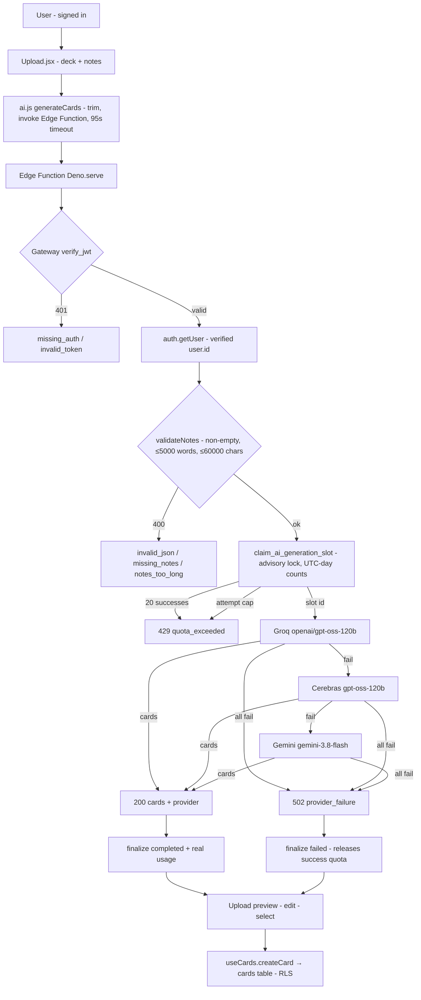

# Built-In AI Generation System — Implementation Report (Phases 0–8)

- **Date:** 2026-10-13
- **Author:** OpenCode working session (Phases 0–8), consolidated for independent review
- **Scope:** Replace browser-direct AI calls (user keys in `localStorage`) with a secure server-side generation system: React frontend → Supabase Edge Function `generate-cards` → Groq → Cerebras → Gemini, with per-user daily quota.
- **Method of this report:** Every claim below was re-checked against the actual code, migrations, and configuration on 2026-10-13 (Phase 8). Test counts are from executed harnesses, not estimates. Anything never executed is marked **NOT RUN** / **NOT VERIFIED**. No secrets are included.

---

## Section 1 — Executive Summary

### Project purpose

FastRev is a student spaced-repetition app (React 19 + Vite 8 + Tailwind v4 + Supabase). Its core loop — paste study notes → AI generates atomic flashcards → preview/edit → save to a deck → FSRS-scheduled review — depended on **each user pasting their own AI provider keys** into a Settings UI. Keys lived in `localStorage` and the browser called Google/Groq/Cerebras directly. That meant key theft via any same-origin script, no per-user quota, and no server-side control.

### Original architecture (before this track)

```
Upload.jsx → src/lib/ai.js → Gemini / Groq / Cerebras (browser fetch, user keys)
  → preview rows → useCards.createCard → Supabase cards table
```

Keys: `gemini_api_key` / `groq_api_key` / `cerebras_api_key` in `localStorage`, managed by `src/pages/Settings.jsx` (+ `/settings` route). Chain order was Gemini → Groq → Cerebras.

### New architecture (after this track)

```
User → Upload.jsx (signed in, deck + notes)
  → supabase.functions.invoke('generate-cards', { body: { notes } })  [JWT]
  → Edge Function (Deno): gateway JWT check → auth.getUser()
  → notes validation → atomic UTC-day quota claim (20 successes/day)
  → Groq → Cerebras → Gemini (server keys, one attempt each)
  → server card validation → 200 { cards, provider } → finalize slot
  → preview / edit / select → useCards.createCard → cards table (RLS)
```

### Main changes implemented

1. **Database** (`supabase/migrations/0003`, `0004`): `ai_generations` ledger (RLS read-own-only, zero write policies), atomic `claim_ai_generation_slot()` (per-user advisory lock, UTC-day success quota + attempt ceiling + TTL expiry), `finalize_ai_generation_slot()` (reserved-and-owner-only). Both RPCs `service_role`-only.
2. **Edge Function** (`supabase/functions/generate-cards/`, 5 `.ts` files + README): dual-layer JWT auth, notes limits (non-empty, ≤5,000 words, ≤60,000 chars), exact-match CORS allowlist, 11-code JSON error contract, live provider chain (verified model IDs), reservation-and-finalization quota wiring.
3. **Frontend**: `ai.js` generation path rewritten to invoke the function (tolerant error mapping, client shape re-validation, 95 s timeout); old browser-direct chain deleted. `Upload.jsx` ungated from keys with friendly copy for all server codes.
4. **Key removal**: `Settings.jsx`/`SettingsPage.jsx` + `/settings` route + nav/menu entries + key helpers + `transcribeImage`/image-import path deleted; CSP drops all provider origins; one-time `localStorage` key purge in `main.jsx`. `dist/` bundle scans clean.
5. **Docs**: `architecture.md` (final architecture section), `AGENTS.md` (track history, decisions, maintenance rules), `README.md` (server-secrets setup), `supabase/README.md` (§ Deploy runbook).

### Current overall implementation status

**Code-complete and build-green. NOT deployed, NOT live-verified.** `oxlint` clean (1 tolerated pre-existing warning), `vite build` ✓, 119 unit + 148 static checks green, `dist/` secret scan clean, 31/31 deploy-config audit green. Migrations 0002–0004 never executed; the function never deployed or served; no live provider call ever made from the new code. All remote steps are the user's procedure (`supabase/README.md` § Deploy).

---

## Section 2 — Phase-by-Phase Summary

### Phase 0 — Audit Existing Project and Prepare Context — COMPLETE

- **Objectives:** Read docs, inspect structure, trace the AI flow, inspect auth/DB/RLS/env/migrations/Edge Function presence. No code changes.
- **Performed:** Read `AGENTS.md` + `architecture.md`; traced `Upload.jsx:209 generateCards()` → `ai.js` chain → provider `fetch()` → `useCards.createCard`; confirmed keys only in `localStorage`, auth via Supabase email/password + `ProtectedLayout`, RLS owner-policies + 0002 hardening SQL (unexecuted), no `supabase/functions/` and no `config.toml`.
- **Files created/modified/deleted:** none.
- **Tests:** n/a (audit). **Remaining:** none — audit delivered. **Status: COMPLETE.**

### Phase 1 — AI Generation Database Foundation — PARTIALLY COMPLETE

- **Objectives:** `ai_generations` usage ledger, index, RLS, secure server-side recording design, atomic quota primitive.
- **Performed:** Created `supabase/migrations/0003_ai_generations.sql`: table (`id` UUID PK `gen_random_uuid()`, `user_id` → `auth.users` `ON DELETE CASCADE NOT NULL`, `created_at` timestamptz `now()`, `tokens_used` int `DEFAULT 0 CHECK >= 0` — default-zero because providers don't reliably return usage, `provider` text, `cards_generated` int default 0); index `(user_id, created_at DESC)`; RLS enabled with exactly one SELECT-own policy for `authenticated` (plus defensive drops of any write-policy names; nothing for `anon`); `SECURITY DEFINER` `claim_ai_generation_slot(uuid, int, int)` holding a per-user advisory transaction lock across count-then-insert, raising `AI_GENERATION_QUOTA_EXCEEDED` (P0001); `EXECUTE` revoked from `public`/`anon`/`authenticated`, granted to `service_role`. Documented in `architecture.md` (§ Database Schema) and `supabase/README.md`.
- **Tests:** 22/22 static checks (no DROP/DELETE, columns/constraints/FK/index, single SELECT policy, lock+insert atomicity markers, exact revoke/grant, balanced syntax). No local Postgres existed, so validation was static + SQL-Editor verification block in the file.
- **Remaining:** migration **never executed** against any database. **Status: PARTIALLY COMPLETE** (implementation done, remote apply + live RLS/isolation checks pending).

### Phase 2 — Secure Edge Function Shell — PARTIALLY COMPLETE

- **Objectives:** `supabase/functions/generate-cards/index.ts` with auth, notes validation (5,000-word limit), consistent errors, server-side secrets, CORS, and wiring points for providers/quota. No fake responses; JWT verification stays on.
- **Performed:** Created `index.ts` (`Deno.serve` handler: OPTIONS preflight → POST-only 405 → exact-match origin gate 403 → bearer check 401 → `auth.getUser()` via anon key 401 → JSON parse 400 → `validateNotes` 400 → quota hook 429 → provider gate 501), pure `validation.ts` (`MAX_WORDS=5000`, `MAX_CHARS=60000`, `countWords`, `validateNotes`), pure `response.ts` (11-code `{ error: { code, message } }` contract, `ALLOWED_ORIGINS` parsing with localhost-dev defaults, substring-proof origin check, CORS headers), `supabase/config.toml` (`verify_jwt = true`), function `README.md` (secrets, local serve, curl matrix). Until Phase 3, valid requests answered 501 with no fake cards.
- **Tests:** 31/31 unit checks (Node 24 type-stripping harness against the real modules: word/char boundaries incl. 5000-ok/5001-reject, allowlist parsing, 6 origin cases incl. `evil-your-app.vercel.app` and `your-app.vercel.app.evil.com` rejections, response shapes/statuses/ACAO behavior) + 20/20 structural checks (4 later superseded by Phases 3–4: `checkQuota` stub, chain-order location, secret-map location, pre-`service_role` state — retired honestly in Phase 7, not edited to pass).
- **Remaining:** never served (`supabase`/Deno CLI absent here); live JWT/preflight untested. **Status: PARTIALLY COMPLETE.**

### Phase 3 — Providers and Fallback — PARTIALLY COMPLETE

- **Objectives:** Server-side chain Groq → Cerebras → Gemini with verified model IDs, timeouts, status/body validation, fallthrough on recoverable errors, no retry loops, validated `{ cards }` output, friendly all-fail error.
- **Performed:** Created `providers.ts` (pure, fetch-injectable): pinned `openai/gpt-oss-120b` (Groq), `gpt-oss-120b` (Cerebras), `gemini-3.8-flash` (Gemini) — IDs verified against live provider docs fetched 2026-10-13 (Groq Production-models page; Cerebras model catalog; Google models page). **Key finding:** Cerebras no longer lists `llama-3.3-70b` (catalog is only `gpt-oss-120b` + `qwen-3.8-27b`), so the old frontend pin was deliberately NOT reused. Chain tries each configured provider at most once (30 s `AbortSignal.timeout` each, 1 MB body guard, no retries/backoff); every provider-side failure (network, timeout/`AbortError`, 429, 503/529/504, 401/403 invalid-key, malformed/unusable output) falls through; first usable set wins. Output validation: fence-stripped parse accepting `[...]` or `{cards:[...]}`, whitelist `question`/`answer`/`source` (extras dropped), empty sets rejected, ≤40 cards, 2000/2000/500 truncation (DB CHECKs), token-usage extraction (OpenAI + Gemini shapes, `null` when absent). `index.ts` wired to return `200 { cards, provider }`, all-fail → `502 provider_failure` (kinds logged server-side only). Docs updated (function README chain table, `architecture.md`).
- **Tests:** 33/33 mock-fetch checks (first-try success with header/model/prompt/usage assertions; 429→Cerebras order + failure record; network→503→Gemini; 4 malformed classes → fallthrough; wrapped/fenced JSON; field stripping; 40-card + length caps; `AbortError`→timeout; 401 fallthrough; no-keys zero-calls; gemini-only; 3-failure aggregate with ordered kinds; empty Gemini candidates; null usage; oversized body) + 11/11 wiring checks (2 fetch call-sites, no loops/eval, no hardcoded key material).
- **Remaining:** **no live provider request was ever made** (no keys/CLI here). **Status: PARTIALLY COMPLETE.**

### Phase 4 — Daily Rate Limiting — PARTIALLY COMPLETE

- **Objectives:** 20 successful generations/user/day (server-configurable), verified-token identity only, UTC window, enforce-before-spend, atomic concurrency safety, trusted recording, no user edits, 429 on exhaustion. Success-counted limit with attempt-abuse protection.
- **Performed:** Created `supabase/migrations/0004_ai_generation_quota.sql`: `status` column (`reserved`/`completed`/`failed`/`expired`, `NOT VALID` CHECK, backfill default `completed`); replaced the 3-arg claim (dropped) with `claim_ai_generation_slot(uuid, int DEFAULT 20, int DEFAULT 60, int DEFAULT 10)` — UTC-midnight boundary computed in UTC on both sides (session-TZ independent), per-user advisory lock, lazy expiry of stale `reserved` rows to `expired` (no cron), success count (`completed` since UTC midnight) → `AI_GENERATION_QUOTA_EXCEEDED`, attempt count (`reserved`+`completed`+`failed` today) → `AI_GENERATION_ATTEMPT_LIMIT` (both P0001); new `finalize_ai_generation_slot()` flips only `reserved` rows matching id+user, null tokens preserve "unknown", returns boolean; both RPCs revoked from `public`/`anon`/`authenticated`, granted to `service_role` only; RLS posture unchanged. Created `quota.ts` (strict digit-parsed `AI_DAILY_LIMIT`/`AI_ATTEMPT_LIMIT`/`AI_RESERVATION_TTL_MINUTES` with defaults 20/60/10, `claimSlot` mapping P0001 details → reasons, `finalizeSlot` returning false on any failure, friendly `quotaMessage`). Wired into `index.ts`: service-role admin client (ledger RPCs only), claim-before-provider with throw→500 guard, finalize-`failed` on provider failure, finalize-`completed` with real usage on success (ledger hiccup logs but never fails the user response).
- **Tests:** 23/23 unit checks (defaults/overrides/7 invalid-env classes — including a found-and-fixed `"1.5x"`→1 silent-parse bug, now strict-digits; below/at/attempt-limit/unexpected-error/transport-throw claims; per-user passthrough; finalize completed/failed args, null-token preservation, already-finalized→false, error/throw→false; message copy) + 29/29 static checks (UTC-both-sides, lock→expire→count→insert order, both P0001 codes, old-signature drop, exact revoke/grant, finalize ownership/boolean, no RLS weakening, claim-before-chain, finalize-both-paths, 429 mapping, service-role server-only).
- **Remaining:** never executed against Postgres (concurrency proof is design + lock-order assertion; live burst test pending). **Status: PARTIALLY COMPLETE.**
- **Fix Phase addendum (2026-10-13):** re-audit confirmed the success gate counted `completed` ONLY, letting parallel bursts overshoot (simulated 19 completed + 40 parallel → 59 held vs limit 20). Corrected forward-only by `0005_quota_slot_accounting.sql` (gate counts HELD slots; same 4-arg signature; 0004 untouched). `finalizeSlot` gained bounded `maxAttempts` (default 1; handler passes 2). Evidence: 19/19 algorithm sim, 7/7 retry unit, 23/23 fix assertions — see "Fix Phase (2026-10-13)" section below. Remote execution still pending.

### Phase 5 — Frontend Refactor to Edge Function — PARTIALLY COMPLETE

- **Objectives:** `ai.js` invokes the function via `supabase.functions.invoke('generate-cards', { body: { notes } })`, validates `data.cards`, preserves deck/notes/Generate/preview/edit/save behavior and double-submit guard, understandable errors per status class, SDK error-shape tolerance, no raw provider internals. Keep the API-key UI (Phase 6 scope).
- **Performed:** Rewrote generation path in `src/lib/ai.js`: Edge invocation with 95 s client timeout, `functionErrorInfo` probing every known SDK wrap shape (`.status` + object/string `context`, returned-vs-thrown), allowlisted server codes pass through (server message preferred, contract-safe), status-only fallbacks (400→`malformed`, 401→`invalid_token`, 403→`origin_not_allowed`, 429→`quota_exceeded`, 500→`server_error`, 501→`provider_not_configured`, 502–504→`provider_failure`, no-status→`network`), client shape re-validation (whitelist + caps + empty rejection), `{ cards, provider, failures: [] }` return shape preserved; old browser-direct chain (Gemini/Groq/Cerebras callers, prompt builder, key-chain assembly) deleted; `transcribeImage` + key helpers kept (Phase 6 scope). `Upload.jsx`: ungated Generate from keys, friendly copy for all server codes, Retry on `server_error`/`provider_failure`, key hint moved to image-import context; deck selector/textarea/preview/edit/save/`?deck=`/import pipeline byte-for-byte.
- **Tests:** 32/32 behavioral checks against the real `ai.js` (stubbed Supabase import): normalization/trimming/stripping, invoke args with no key material, 5 malformed shapes, 7 returned-error codes with server-message preference, string-context parsing, 9 status-only mappings, fetch-style→network, thrown-HTTP recovery, unknown-code fallback without leak, labels + 24/24 structural checks (old chain gone repo-wide, OCR/keys intact, Upload affordances preserved).
- **Remaining:** no live end-to-end (needs deployed function + secrets). **Status: PARTIALLY COMPLETE.**

### Phase 6 — Remove Client-Side Key Management — COMPLETE

- **Objectives:** Remove key forms/modals/banners/Settings-links, client fallback logic, localStorage key I/O, obsolete provider code; delete `Settings.jsx` iff exclusively key management; security audit sweep; preserve unrelated features; keep Supabase anon config.
- **Performed:** Deleted `src/pages/Settings.jsx` + `src/pages/SettingsPage.jsx` (verified exclusively key management), `/settings` route (`App.jsx`), nav entry + title (`nav.js` → 5 items), `UserMenu` Settings item (sign-out only), `MobileMenu` comment, all `Upload.jsx` Settings affordances + dead key-era error cases + image accept/size branches (copy adjusted: no screenshot advice), key helpers/`PROVIDERS`/`STORAGE_KEYS`/`transcribeImage`/direct-request helpers/Gemini constants from `ai.js`, image branch from `extract.js` (`SUPPORTED_INPUTS` = `PDF, .txt, .md, .docx`), provider origins from `vercel.json connect-src`, one-time `localStorage` key purge in `main.jsx`; updated `README.md` (server-secrets setup) + `architecture.md`. Audit: `src/` grep for key names/endpoints/Settings/image refs → only theme-`localStorage` + purge lines; git history holds only `'AIza…'`/`'gsk_…'` placeholders → no rotation owed.
- **Tests:** 20/20 removal checks + 32/32 `ai.js` re-runs green. Static verification only (no browser tooling); live Upload walkthrough pending.
- **Known trade-off (loud):** image/screenshot import **paused** — it required the user key for OCR. **Status: COMPLETE** (removal itself is fully verifiable statically).

### Phase 7 — Test and Deploy Prep — PARTIALLY COMPLETE

- **Objectives:** Run available checks; report (don't install around) missing CLI; verify secrets workflow without values; provide (not execute) migration/deploy commands; E2E + browser-security verification; honest passed/not-run split.
- **Performed:** Real `oxlint 1.81.0` clean (1 tolerated `button.jsx` warning); real `vite build` ✓ (7.68 s; required a fresh gitignored `npm install` — no repo files touched); all suites re-run green (119 unit; 148 static with 9 honestly retired as superseded); `dist/` secret scan clean (only purge literals, confirmed in context); new 31/31 deploy-config audit (dual-layer JWT, env-docs hygiene, migration order/idempotency, service-role-only RPCs, 11-code consistency server→client→UI, quota-20 consistency, CSP); added `supabase/README.md` § Deploy runbook (link → 0001→0004 → secrets → deploy → verification matrix → Vercel build). Supabase CLI/Deno confirmed absent → prerequisite reported, nothing deployed, nothing live-tested.
- **Remaining:** everything remote. **Status: PARTIALLY COMPLETE** (all runnable checks done; deploy + live verification are the user's).

### Phase 8 — Docs and Final Architecture — COMPLETE

- **Objectives:** `AGENTS.md` + `architecture.md` describe the verified system (stack, flow, security, setup, maintenance rules); final audit vs code; final check run. Docs only.
- **Performed:** `AGENTS.md` (Current/Next Phase, track-local Phases 0–7 history, stack + constraints, edge-track decisions, new Maintenance Rules section, superseded-risk annotations, corrected File Index, dated entry) and `architecture.md` (High-Level Flow, Component Map, Security posture, External Services, Data Flow, new § AI Generation System (Final Architecture), `.ts`-scope fix, stale Phase-11 SettingsPage list fixed, supersede annotations on two dated bullets). Final audit: all 22 referenced files resolve; `src/` holds only purge-literal key references; lint re-run clean.
- **Tests:** documentation-vs-code consistency sweep (no new app tests; nothing to test in prose). **Status: COMPLETE.**

### Fix Phase — Quota-Bypass Audit and Fix (2026-10-13) — PARTIALLY COMPLETE

- **Objectives:** Audit the track against its own reports (not just the code); fix the daily-quota bypass; DB security re-audit; provider/frontend re-audit; deployment-readiness re-survey; regression tests; docs; no rebuild, no invented results, no remote ops.
- **Audit finding (confirmed bug):** 0004's success gate counted `status='completed'` only. Active `reserved` rows were invisible to the 20-limit, so N parallel claims each observed the pre-burst count and all inserted (the 60-attempt ceiling being the only backstop). Worst case (19 completed + 40 parallel): **59 held vs limit 20**. Root cause: the Phase 4 checks asserted the count query existed, not what it counted.
- **Fix performed:** `supabase/migrations/0005_quota_slot_accounting.sql` (forward-only; 0004 byte-identical): success gate counts HELD slots (`completed` + active `reserved`) since UTC midnight; same 4-arg signature (callers unchanged); lockdown re-asserted; 0004-ordering guard; attempt gate, TTL expiry, UTC boundary, finalize function untouched (all re-verified correct). `quota.ts finalizeSlot(db, slot, outcome, maxAttempts = 1)` — bounded retries (definitive no-ops never retried; default preserves single-attempt semantics); `index.ts` passes 2 on both finalize paths, with the fail-open trade-off documented in code. Provider chain, frontend integration, RLS posture re-audited — no changes warranted (model IDs verified same-day; no live calls exist to regress).
- **Files created:** `supabase/migrations/0005_quota_slot_accounting.sql`. **Modified:** `supabase/functions/generate-cards/quota.ts`, `supabase/functions/generate-cards/index.ts`, `supabase/README.md` (0001→0005 order), `AGENTS.md`, `architecture.md`, this report. **Deleted:** none. **DB/config changes:** 0005 only (written, not executed).
- **Tests:** 19/19 algorithm simulation (S1 fresh-claim, S2 19→20th granted then denied, S3 20→denied, S4 19+40-parallel caps at exactly 20 across 5 adversarial runs, S4b grant→complete→denied, S5 failure releases, S6 double-finalize counts once, S7 fresh-burst 40→exactly 20 across 5 runs, S8 per-user independence, S9 foreign-finalize rejected, S10 TTL abandonment reusable; **negative control: old completed-only predicate overshoots to 59, proving the sim detects the bug**); 7/7 retry unit (defaults, bounded 3-call cap, definitive-false single call, invalid attempts→1); 23/23 fix assertions (gate predicate, signature, codes, order, guard, no table/policy changes, lockdown, wiring, parens); full regression green (lint 1 tolerated, build ✓, all prior suites, `dist/` scan). **Scope honesty:** the sim models SQL predicates with a JS mutex — it proves the algorithm, not PostgreSQL; PG proof remains lock-order assertion + the live burst recipe in 0005's verification block. No Deno/CLI/Docker/PG existed here, so no local-PG concurrency test was possible.
- **Remaining:** migrations 0002–0005 unexecuted; function undeployed; no live verification. **Status: PARTIALLY COMPLETE** (same class as Phases 1–5, 7).

---

## Section 3 — Final Architecture

Request flow (matches `index.ts:51-208`, `quota.ts`, `providers.ts`, `ai.js:generateCards`, `Upload.jsx`):



- **Authentication:** Supabase email/password (`useAuth`); `/upload` behind `ProtectedLayout`; function gateway `verify_jwt=true` (`supabase/config.toml:6`) plus in-handler `auth.getUser()` on the bearer token (`index.ts:89-99`); verified `user.id` flows into `claimSlot(admin, userId, …)` (`index.ts:136`); request bodies are never trusted for identity.
- **Frontend (`ai.js`)**: invokes `generate-cards` with `{ body: { notes } }`; `_apiKeys` param kept but ignored; tolerant error mapping across SDK wrap shapes; client re-validation (`normalizeServerCards`); `providerLabel` maps server ids (`groq`/`cerebras`/`gemini`) for the "generated with …" caption.
- **Fallback:** order Groq → Cerebras → Gemini (`providers.ts:17`); one attempt each, 30 s timeouts, no retries; every failure class (network, timeout, 429, 503/529/504, invalid key, malformed/unusable output) falls through; first usable set wins.
- **Validation:** server parses fence-stripped JSON (`[...]` or `{cards:[...]}`), drops rows without trimmed Q+A, strips unknown fields, caps 40 cards / 2000/2000/500 chars (DB CHECKs); 1 MB body guard; generated content is only JSON-parsed, never executed.
- **Preview/save:** unchanged two-panel UI — select-all + counts, inline edit with focus management, removal focus, Save All/Save Selected with partial-failure retention, toast + redirect to `/decks/:id`; `useCards.createCard` adds FSRS defaults + `user_id`, RLS + ownership trigger enforce deck ownership.
- **Quota/logging:** claim-before-spend; success finalizes `completed` with provider-reported totals (`null` → stays 0/"unknown"); failures finalize `failed`; abandoned `reserved` rows expire after TTL and are lazily marked `expired`; 20 successes + 60 attempts per UTC calendar day (env-tunable, server-only); over-quota → 429 with friendly copy; logs carry user id + outcome codes only.

---

## Section 4 — Final File Structure

### Supabase / server (all created in this track except migrations 0001–0002)

| File | Purpose | State |
|---|---|---|
| `supabase/config.toml` | Function config: `[functions.generate-cards]`, `verify_jwt = true` | Created (P2) |
| `supabase/functions/generate-cards/index.ts` | `Deno.serve` handler: CORS → method → origin → JWT → body → quota claim → chain → finalize → response | Created (P2), extended (P3, P4) |
| `supabase/functions/generate-cards/providers.ts` | Chain, model IDs/URLs, prompt, parse/validate, usage readers, timeouts | Created (P3) |
| `supabase/functions/generate-cards/quota.ts` | Server quota config, `claimSlot`, `finalizeSlot`, `quotaMessage` | Created (P4) |
| `supabase/functions/generate-cards/response.ts` | 11-code contract, allowlist CORS, `jsonError`/`jsonOk` | Created (P2) |
| `supabase/functions/generate-cards/validation.ts` | Notes limits + `validateNotes`/`countWords` | Created (P2) |
| `supabase/functions/generate-cards/README.md` | Secrets, local serve, curl matrix, chain table | Created (P2), extended (P3, P4) |
| `supabase/migrations/0003_ai_generations.sql` | Ledger table + index + RLS + v1 claim fn | Created (P1), **not executed** |
| `supabase/migrations/0004_ai_generation_quota.sql` | `status` lifecycle + v2 claim + finalize fn | Created (P4), **not executed** |
| `supabase/migrations/0001_initial_schema.sql` | decks/cards/review_logs + RLS | Retained, untouched |
| `supabase/migrations/0002_authorization_hardening.sql` | Ownership triggers + length CHECKs | Retained, untouched, **not executed** |
| `supabase/schema.sql` | Canonical full schema (predates track) | Retained, untouched |
| `supabase/README.md` | SQL run-book + § Deploy runbook | Modified (P1, P4, P7) |

### Frontend (modified in this track)

| File | Purpose | State |
|---|---|---|
| `src/lib/ai.js` | Edge Function client (`generateCards`), `AiError`, `providerLabel`, caps | Modified (P5, P6) — generation path rewritten, key/OCR/provider code deleted |
| `src/pages/Upload.jsx` | Deck select, notes, local import, Generate, preview/edit/save, error copy | Modified (P5, P6, P7) — ungated, server error codes, no Settings, no image accept |
| `src/lib/extract.js` | Local PDF/DOCX/TXT/MD extraction | Modified (P6) — image/OCR branch deleted |
| `src/lib/nav.js` | 5 NAV_ITEMS, titles, link classes | Modified (P6) — `/settings` removed |
| `src/App.jsx` | Routes (no `/settings`), lazy pages | Modified (P6) — route + import removed |
| `src/components/UserMenu.jsx` | Sign-out-only account menu | Modified (P6) |
| `src/components/MobileMenu.jsx` | Hamburger nav dialog | Modified (P6) — comment only |
| `src/main.jsx` | Entry + Toaster + one-time key purge | Modified (P6) — purge added |
| `src/lib/supabase.js` | Anon-key client singleton | Retained, untouched |
| `src/hooks/useCards.js` | Card CRUD + FSRS defaults | Retained, untouched |
| `vercel.json` | Security headers + CSP (no provider origins) | Modified (P6) |
| `.env.example` | Only `VITE_SUPABASE_URL`/`VITE_SUPABASE_ANON_KEY` | Retained, verified clean |

### Deleted

`src/pages/Settings.jsx`, `src/pages/SettingsPage.jsx` (both exclusively key management — verified before deletion).

### Docs (this track)

`architecture.md`, `AGENTS.md`, `README.md` modified; no test-runner or harness files committed (all harnesses live in `%TEMP%\opencode\phaseN\`, per project convention).

---

## Section 5 — Database and Security

### `ai_generations` schema (migration 0003, extended by 0004)

```sql
create table if not exists public.ai_generations (
  id uuid primary key default gen_random_uuid(),
  user_id uuid not null references auth.users (id) on delete cascade,
  created_at timestamptz not null default now(),
  tokens_used integer not null default 0 check (tokens_used >= 0),
  provider text,
  cards_generated integer not null default 0 check (cards_generated >= 0),
  status text not null default 'completed'      -- added by 0004
);
alter table public.ai_generations add constraint ai_generations_status_values
  check (status in ('reserved','completed','failed','expired')) not valid;
create index if not exists ai_generations_user_created_idx
  on public.ai_generations (user_id, created_at desc);
```

`tokens_used` defaults to 0 because Groq/Cerebras `usage` and Gemini `usageMetadata` are not reliably present — 0 means "unknown", never a bill. Pre-existing rows (if any) backfill `status='completed'` (conservative: past usage counts).

### RLS

Enabled; exactly one policy, both migrations combined:

```sql
create policy "ai_generations_select_own" on public.ai_generations
  for select to authenticated using (auth.uid() = user_id);
```

Zero insert/update/delete policies and nothing for `anon` — with RLS on, every direct browser write is denied (default-deny). Migration 0003 additionally drops any write-policy names defensively; 0004 adds no policies and no table grants (verified by assertion).

### Server-side recording

Only the Edge Function, using `SUPABASE_SERVICE_ROLE_KEY` (function env, auto-injected on deploy; never in code/docs/frontend), may write — via the two RPCs below, never raw table access. The anon key in the bundle cannot write this table.

### Claim (quota gate) — `claim_ai_generation_slot(uuid, int=20, int=60, int=10) → uuid` (final shape per 0005; 0004's version counted `completed` only — see Fix Phase note)

Single transaction: validate args → UTC-midnight boundary (`date_trunc('day', now() at time zone 'UTC') at time zone 'UTC'` — session-TZ independent) → `pg_advisory_xact_lock(hashtextextended(user_id))` → expire stale `reserved` rows older than TTL to `expired` → count HELD slots (`completed` + active `reserved`) since UTC midnight (≥ limit → `AI_GENERATION_QUOTA_EXCEEDED`/P0001) → count `reserved`+`completed`+`failed` today (≥ attempt cap → `AI_GENERATION_ATTEMPT_LIMIT`/P0001) → insert `reserved` row, return id. Concurrent requests for one user serialize on the lock: the limit cannot overshoot. The Phase 1 rolling-window 3-arg version is dropped by 0004 so exactly one claim signature exists.

### Finalize — `finalize_ai_generation_slot(uuid, uuid, text, int=null, text=null, int=0) → boolean`

Updates only the row matching id **and** user **and** `status='reserved'`; rejects other statuses; null tokens preserve existing value; returns `row_count = 1` (double-finalize/foreign-slot → `false`, never an error that moves quota).

### AuthZ summary

`EXECUTE` on both RPCs revoked from `public`/`anon`/`authenticated`, granted to `service_role` only (Postgres default-grants `PUBLIC`, so the revokes are load-bearing — asserted). Cross-user access is blocked at three layers: RLS (reads), no write policies (direct writes), RPC ownership checks (ledger moves). The handler passes only the `auth.getUser()`-verified id.

### Previously exposed keys

Git history contains only `'AIza…'`/`'gsk_…'` **placeholder strings** in the deleted `Settings.jsx` plus audit-doc mentions — no real credential was ever committed (verified `git grep` across all revs). Pasted user keys lived only in their own browsers → provider endpoints, and are purged on app load. **No rotation is owed** on that basis; rotate at the provider console only if a key was ever shared. Deleting code does not invalidate keys already in users' browsers — the purge + removal of all readers makes leftovers inert.

---

## Section 6 — AI Provider Integration

| # | Provider | Model ID | Endpoint | Verified |
|---|---|---|---|---|
| 1 primary | Groq | `openai/gpt-oss-120b` | `POST api.groq.com/openai/v1/chat/completions` (OpenAI-compatible, Bearer) | Docs (Production-models page, fetched 2026-10-13). **No live call.** |
| 2 fallback | Cerebras | `gpt-oss-120b` | `POST api.cerebras.ai/v1/chat/completions` (OpenAI-compatible, Bearer) | Docs (Shared Inference catalog, fetched 2026-10-13). **No live call.** Old `llama-3.3-70b` is delisted and was NOT reused. |
| 3 fallback | Gemini | `gemini-3.8-flash` | `POST generativelanguage…/models/gemini-3.8-flash:generateContent?key=` with `generationConfig.responseMimeType: application/json` | Docs (Google models page, fetched 2026-10-13) + prior live frontend use of the same model. **No live call from the new code.** |

- **Request shape:** system "JSON array only" + user prompt (10–15 atomic cards, `{question,answer,source}`), `temperature 0.4` (OpenAI-compatible). No `response_format` flag — prompt-enforced JSON, the shape proven by the old frontend.
- **Response validation:** fence-strip → `JSON.parse` → accept array or `{cards:[...]}` → drop rows lacking trimmed Q+A → strip unknown fields → ≤40 cards, 2000/2000/500 chars. Empty/unusable → provider failure → fallthrough.
- **Timeout/retry:** 30 s `AbortSignal.timeout` per provider (timeout classed separately from network); each configured provider tried **at most once** — no retries, no backoff (exactly 2 `fetchImpl` call-sites asserted).
- **Failure classes:** `rate_limit` (429), `unavailable` (503/529/504), `invalid_key` (401/403 or key-words in body), `network`, `timeout`, `malformed`, `provider_error` (everything else incl. retired-model 404s). **All** classes fall through (keys are independent); failure `{provider, kind[, status]}` accumulates for server logs only.
- **Missing keys:** providers without a secret are skipped (`chainForKeys`); zero configured → handler 501 `provider_not_configured` (generic copy, never reveals which secrets exist).
- **All fail:** `502 provider_failure`, "Couldn't generate cards right now. Try again in a minute." — no bodies, statuses, or key hints leave the function.
- **Live-vs-mock honesty:** every provider behavior above is **mock-verified only** (33 checks). No real API request has been made from `providers.ts`. Do not treat the chain as production-proven until the § Deploy matrix runs with real secrets.

---

## Section 7 — Frontend Changes

- **`src/lib/ai.js`**: generation path rewritten to `supabase.functions.invoke('generate-cards', { body: { notes } })` (95 s `Promise.race` timeout); `_apiKeys` compat param ignored; `functionErrorInfo` probes all known SDK shapes (returned `{data,error}` vs thrown errors, object vs string `context`); allowlisted server codes pass through with server message preferred; status-only fallbacks; no-status → `network`; client re-validates `data.cards`; returns legacy `{ cards, provider, failures: [] }` so `Upload.jsx` meta display works unchanged. Deleted: direct provider callers, prompt builder, fence parsing, key-chain assembly, key storage helpers, `transcribeImage`, request helpers, provider URL/model constants. Kept: `AiError`, caps, `providerLabel` (Cerebras label corrected to GPT-OSS 120B).
- **`src/pages/Upload.jsx`**: Generate ungated from keys (notes + !generating; existing re-entry guard kept); friendly copy for all 11 server codes (+ `invalid_json`/`invalid_method` generic); Retry on `network`/`server_error`/`provider_failure`, Try-again on `malformed`; `generateCards(notes.trim())`; key hint relocated-then-removed with the OCR path; `accept` drops `image/*`; scanned-PDF error advises pasting text. Preserved byte-for-byte in behavior: deck selector, notes textarea + char count, dropzone (minus images), preview/select-all, inline edit + focus, removal focus, Save All/Save Selected + partial-failure retention, toast + redirect, `?deck=` preselect, decks-load retry.
- **Removed UI**: key inputs/modals/banners, all "Open Settings" buttons, `Settings.jsx`/`SettingsPage.jsx`, `/settings` route, 6th nav item (5 now), user-menu Settings entry.
- **Removed storage**: all `localStorage` key I/O; one-time purge of the three legacy key slots in `main.jsx` (theme storage untouched).
- **Loading/error states**: unchanged grammar (skeletons, `role="status"`/`role="alert"`, `aria-busy`, `LoadingButton`); only copy and available actions changed.

---

## Section 8 — Environment and Deployment

### Secrets and variables (names only — no values anywhere in this report or repo)

| Name | Where | Purpose |
|---|---|---|
| `VITE_SUPABASE_URL` / `VITE_SUPABASE_ANON_KEY` | `.env` (local) + Vercel env (build time) | Public client config (RLS-gated by design) |
| `GROQ_API_KEY` / `CEREBRAS_API_KEY` / `GEMINI_API_KEY` | `supabase secrets set` (server only) | Provider chain (≥1 required; absences skipped gracefully) |
| `ALLOWED_ORIGINS` | `supabase secrets set` | Exact-match CORS allowlist (unset = localhost dev only; **must** be the Vercel domain in prod) |
| `AI_DAILY_LIMIT` / `AI_ATTEMPT_LIMIT` / `AI_RESERVATION_TTL_MINUTES` | `supabase secrets set` (optional) | Quota tuning, defaults 20/60/10, strict-digit parsing |
| `SUPABASE_URL` / `SUPABASE_ANON_KEY` / `SUPABASE_SERVICE_ROLE_KEY` | Auto-injected by Functions runtime (local: `.env.local`, gitignored) | Token validation (anon) + ledger RPCs (service_role) |

### Local prerequisites and commands

- Node 20.19+ / npm; `npm install`; `npm run dev` / `lint` (`oxlint`) / `build` (`vite build`) / `preview`. No test/typecheck scripts exist (JS-only project).
- Supabase CLI: **not installed or version-verified in the build environment** — install per supabase.com/docs, confirm with `supabase --version`, `supabase login`, `supabase link --project-ref …`, `supabase start` (needs Docker), `supabase functions serve generate-cards --env-file …`, `supabase secrets set …`, `supabase functions deploy generate-cards`. The runbook uses standard CLI commands; verify flags against the installed version.
- Deno: not installed here; required only by the CLI runtime, not by developers directly.
- Migrations: paste 0001→0005 in order in the SQL Editor (or `supabase db push` when linked; never `db reset` on live data), running each file's commented verification block.

### Deployment status: NOT DEPLOYED

Nothing remote was executed in this track (no authorization, no credentials, no CLI). Dashboard config required from the user: Site/Redirect URLs (Vercel domain), email-confirmation preference, secrets listed above, Vercel build-time `VITE_*` vars.

### Remaining manual steps

Full prioritized checklist in Section 12.

---

## Section 9 — Testing Results

| Test | Expected Result | Actual Result | Status |
|---|---|---|---|
| `oxlint` | 1 tolerated warning | 1 pre-existing `button.jsx` warning, 0 from track files | PASS |
| `vite build` | Success | ✓ (7.68 s fresh; 1.89 s re-run) | PASS |
| Type checks | n/a (JS project) | No `typecheck` script exists | NOT RUN (n/a) |
| Notes validation (empty/blank/5000-ok/5001-reject/60000-ok/60001-reject/trim) | Correct codes | 31/31 harness checks | PASS (mock/unit) |
| CORS allowlist + origin attacks | Exact-match allow, evil origins denied, no ACAO on deny | All cases pass incl. prefix/suffix/subdomain tricks | PASS (unit) |
| Authenticated generation (live) | 200 `{cards,provider}` + ledger `completed` | Never executed (no deploy/keys) | NOT RUN |
| Missing bearer / bad token (live) | 401 `missing_auth`/`invalid_token` | Code-reviewed only; unit-tested client mapping (32 checks) | NOT VERIFIED live |
| Malformed JSON body (live) | 400 `invalid_json` | Code path reviewed; client mapping unit-tested | NOT VERIFIED live |
| Missing/oversized notes (live) | 400 `missing_notes`/`notes_too_long` | Unit-tested both layers (validation.ts + ai.js mapping) | NOT VERIFIED live |
| Provider fallback order (live) | Groq→Cerebras→Gemini, kinds recorded | 33/33 mock-fetch checks (order, fallthrough classes, caps, stripping) | PASS (mock) / NOT VERIFIED (live) |
| Invalid AI JSON (live) | Fallthrough → next provider | Mock-verified (4 malformed classes) | PASS (mock) / NOT VERIFIED (live) |
| All providers fail (live) | 502 generic + reservation released | Mock-verified incl. `failed` finalize args | PASS (mock) / NOT VERIFIED (live) |
| Daily quota: below/at/attempt-cap (live) | Allow / 429 / 429 | Unit-tested `claimSlot` mapping (23 checks); SQL lock-order asserted | PASS (unit) / NOT VERIFIED (live) |
| Concurrent burst at limit (live) | Exactly N successes, no overshoot | Design + lock-order assertion only | NOT RUN |
| Quota slot accounting (fix verification) | Bursts cap at 20; failures release; no double-count | 19/19 algorithm sim (5 adversarial runs each; negative control overshoots to 59 on old predicate) | PASS (model — proves algorithm, not PG) |
| Real-Postgres apply + burst suite (audit) | 0003→0005 apply cleanly; 40-way bursts cap at exactly 20; TTL/RLS/grants/UTC correct | Local PG 17.11, actual files, 27/27 green (4 burst runs) | PASS (local PG — not Supabase) |
| Migration compile audit | All RAISE statements compile | Clean-room apply caught bare-`%` bug in 0003/0004 (fixed `%%`); re-apply + idempotent re-runs exit 0 | PASS (after fix) |
| Finalize retry boundedness | Transient retry ≤N calls; definitive no-op single call | 7/7 unit checks (incl. exactly-3-calls cap, invalid attempts→1) | PASS (unit) |
| Fix wiring + forward-only SQL | Held-slot gate, same signature, 0004 untouched, lockdown re-asserted | 23/23 static assertions | PASS (static) |
| Separate user quotas (live) | Independent budgets | Per-`user_id` lock/count asserted in SQL; id passthrough unit-tested | NOT VERIFIED live |
| Cross-user ledger access | Denied reads/writes | RLS default-deny + no write policies + RPC ownership asserted; **local-PG proven** (select isolation, insert/update/delete denials, grant denials) | PASS (local PG) / NOT VERIFIED (Supabase JWT wiring) |
| Reservation cleanup on failure/crash (live) | `failed` / TTL `expired` | Code paths reviewed; `finalize→false` unit-tested | NOT VERIFIED live |
| Card preview + save (live E2E) | Preview → Save All → deck page | Unchanged code paths; no live session here | NOT RUN |
| Browser storage inspection (live) | No `*_api_key` values | `dist/` bundle scan clean (only purge literals, confirmed in context) | PASS (bundle) / NOT RUN (live DevTools) |
| Network inspection (live) | Calls only to `…/functions/v1/generate-cards` | Guaranteed by code (single invoke site) + CSP forbidding providers | NOT VERIFIED live |
| Deployment verification | § Deploy matrix green | Not deployed | NOT RUN |
| Migration apply (0002–0004) | Success + verification blocks green | Written, idempotent, never applied | NOT RUN |
| Quota/contract consistency audit | 11 codes + limit-20 consistent | 31/31 deploy-config checks | PASS (static) |
| Full suite re-runs (P7/P8) | Green | 119 unit + 148 static green (9 retired as superseded, documented) | PASS |

---

## Section 10 — Security Audit

| Question | Verdict | Evidence |
|---|---|---|
| Provider keys remain in frontend code? | **No** | Repo-wide `src/` grep for key names/endpoints/Settings/image refs → only theme-`localStorage` + purge `removeItem` lines; `dist/` scan → only purge literals (confirmed in context) |
| Keys in localStorage/sessionStorage? | **No live readers/writers** | All key helpers deleted; one-time purge removes legacy values on load; no `setItem`/`getItem` for keys anywhere |
| Browser calls AI providers directly? | **No** | Single network call site for generation: `supabase.functions.invoke`; provider URLs exist only in `supabase/functions/` (Deno, server) |
| Secrets in VITE_* vars? | **No** | `.env.example` holds only the 2 Supabase vars + an explicit never-put-secrets warning; `src/` has no `VITE_*` provider/service-role reads |
| JWT verification enabled? | **Yes (dual layer)** | `config.toml verify_jwt=true` + `auth.getUser()` in-handler; `verify_jwt=false` appears nowhere outside a prohibitive comment; verified-user id only |
| RLS prevents cross-user access? | **Enforced (local-PG proven); Supabase wiring NOT VERIFIED live** | Read-own SELECT only, zero write policies, no anon policies (asserted); local-PG sessions prove isolation + denials; ownership triggers in 0002 (unexecuted); live two-user test pending |
| Users can manipulate own ledger rows? | **No (by construction)** | No write policies (direct writes denied); RPCs service_role-only; finalize requires `reserved`+owner match and returns boolean |
| Concurrent bypass of quota? | **Prevented by design, NOT RUN live** | Per-user advisory xact lock + single-transaction check-expire-count-insert (order asserted); live burst test pending |
| Logs expose sensitive info? | **No** | Handler/provider logs carry user id + outcome codes + kinds only (asserted: no notes/tokens/keys/bodies in any `console.*` line) |
| Committed credentials need rotation? | **No** | `git grep` across all revs: only `'AIza…'`/`'gsk_…'` placeholders + audit mentions; no `.env` ever committed; localStorage keys were per-browser and are now purged/inert. Rotate at provider console only if a key was ever shared |

**Recommended fixes (all pending user action):** execute migrations 0001→0005; deploy with secrets; run the § Deploy live matrix (especially two-user RLS + burst + 429 tests); keep third-party scripts off the origin permanently; re-check vendor model catalogs on any silent provider skip.

---

## Section 11 — Known Issues and Technical Debt

**Confirmed and fixed (Fix Phase 2026-10-13):**
0. 0004 completed-only success gate → parallel-burst overshoot (~59 vs 20). Fixed by 0005 (held-slot gate). Algorithm-sim verified incl. negative control; live burst test still pending.
0b. Bare-`%` RAISE placeholders in 0003 (×1) and 0004 (×2) fail PL/pgSQL compilation — those files could never have applied as written (found by clean-room apply on local PG 17.11; every static check missed it). Fixed as literals-only `%%`; no semantic change; 0003→0005 re-apply + idempotent re-runs exit 0.
1. Migrations 0002–0004 written but never executed — ledger/quota/triggers don't exist remotely.
2. Function written but never served/deployed; no live call of any kind made from the new code.
3. Image/screenshot import disabled (no server OCR endpoint) — loud trade-off with documented follow-up.
4. Model IDs can drift: retired IDs fail as silent 404 fallthroughs (by design, but operators must notice skips).
5. `finalizeSlot` log-and-continue: a ledger hiccup after successful generation is only logged — prolonged DB outage would silently under-count quota (fail-open on accounting, fail-safe on user experience). Consider alerting on repeated finalize failures.
6. Pre-existing, untouched: `mammoth→sprintf-js` moderate advisory (SEC-14); analytics 1000-row cap; no deck-rename UI (U-08); no password reset/OAuth.

**Possible risks needing investigation (live):** PostgREST `P0001` detail-shape assumptions in `claimSlot` mapping (verified against documented behavior, not a live error); Edge Function cold-start latency vs 95 s client timeout under triple-fallback worst case; `ALLOWED_ORIGINS` misconfiguration locking out production browsers (403 on every call — loud, fixable in seconds).

---

## Section 12 — Remaining Manual Tasks

- [ ] 1. Install Supabase CLI + Docker; `supabase login`; `supabase link` and **confirm the project ref** matches the dashboard.
- [ ] 2. Apply migrations **0001 → 0002 → 0003 → 0004 → 0005** in the SQL Editor, running each file's verification block.
- [ ] 3. `supabase secrets set GROQ_API_KEY=… CEREBRAS_API_KEY=… GEMINI_API_KEY=…` (≥1; all three recommended) + `ALLOWED_ORIGINS=https://your-app.vercel.app`.
- [ ] 4. `supabase functions deploy generate-cards` (explicitly authorized by you when ready).
- [ ] 5. Run the live matrix (`supabase/README.md` § Deploy step 5): 401s → first 200 → 21st-success 429 → cross-user RLS → concurrent burst → DevTools storage/network check.
- [ ] 6. `npm run build` + Vercel deploy with build-time `VITE_SUPABASE_URL`/`VITE_SUPABASE_ANON_KEY`; set Supabase URL Configuration (Site + Redirect URLs).
- [ ] 7. Decide the image-OCR follow-up (server transcription endpoint vs. staying paused).
- [ ] 8. Re-run `npm audit` before release; schedule the Supabase keep-awake ping.

---

## Section 13 — Final Acceptance Checklist

| # | Criterion | Verdict | Explanation |
|---|---|---|---|
| 1 | Users can generate cards without entering an API key | **PASS** (code) / NOT VERIFIED (live) | Generate path needs no key in code; live click-through pending deploy |
| 2 | Provider API keys remain server-side | **PASS** | Secrets-only access, zero key material in `src/`+`dist/`, CSP forbids provider origins |
| 3 | Frontend uses the Edge Function for AI generation | **PASS** | Single invoke site; old chain deleted (grep-verified) |
| 4 | Configured fallback chain works | **PARTIALLY PASS** | Logic mock-verified 33/33; no live provider call exists |
| 5 | Daily limits enforced for authed users | **PARTIALLY PASS** | Claim/finalize logic + SQL asserted; local-PG proven (bursts, TTL, finalize); remote execution pending |
| 6 | Concurrent requests cannot bypass quota | **PARTIALLY PASS** | Lock-ordered atomic design + held-slot fix asserted; algorithm-sim + **real-PG 40-way bursts (4 runs) cap at exactly 20**; Supabase-remote burst test pending |
| 7 | Users cannot access others' records | **PARTIALLY PASS** | RLS default-deny + RPC ownership asserted; two-user test NOT RUN |
| 8 | Generated cards follow app schema | **PASS** | Server + client validation, caps match DB CHECKs (mock-verified) |
| 9 | Card previews and saving still work | **PASS** (code) / NOT VERIFIED (live) | Paths byte-preserved; live session pending |
| 10 | Failures produce understandable errors | **PASS** | All 11 codes have friendly copy in UI; raw internals never surface (unit-verified) |
| 11 | Project builds and passes available tests | **PASS** | `oxlint` clean, `vite build` ✓, 119+148 checks green |
| 12 | Documentation reflects implementation | **PASS** | Re-audited 2026-10-13; deploy/live items explicitly marked undone |

---

## Section 14 — Questions for ChatGPT Review

1. **Quota atomicity:** `claim_ai_generation_slot()` serializes per-user work with `pg_advisory_xact_lock(hashtextextended(user_id))` inside one transaction (count-expire-insert). Is there any interleaving under `READ COMMITTED` (e.g. two claims, one finalize) that can overshoot the 20-success limit? Is `hashtextextended` collision handling needed?
   → Fix Phase answer (design-level, needs DBA confirmation live): with the 0005 held-slot gate, every claim observes all committed `completed` + `reserved` rows of its user (the lock serializes claims; finalize is a separate single-row conditional UPDATE that cannot create a row). A finalize racing between another claim's count and insert can only *release* a slot (never over-allocate beyond one extra grant that the next claim then sees). Residual question for review: lock-key collision across different users (64-bit hash) would serialize unrelated users (liveness, not correctness) — acceptable?
2. **UTC-day boundary:** `date_trunc('day', now() at time zone 'UTC') at time zone 'UTC'` compared against `created_at timestamptz` with the `(user_id, created_at)` index. Correct under any session `TimeZone`, and DST-proof? Any planner/index pitfall?
3. **Attempt ceiling (60) vs success limit (20):** is counting `failed` rows toward a separate ceiling the right abuse control, or should repeated provider failures throttle the user sooner (e.g. backoff)? Is letting `expired` rows escape the attempt count abusable (intentional abandonment loop)?
4. **`finalize` returning boolean + log-and-continue:** is silent under-counting acceptable, or should finalize failure fail the user response / trigger an alert? What ledger-reconciliation would you add?
5. **Service-role scope:** the function holds `SUPABASE_SERVICE_ROLE_KEY` for two RPCs (both locked to `service_role`, RLS bypass inherent). Is there a least-privilege alternative (e.g. `authenticated`-callable `SECURITY DEFINER` claim keyed to `auth.uid()` instead of a passed id)? What breaks?
6. **`verify_jwt=true` + in-handler `getUser()`:** redundant or defense-in-depth? Any request the gateway accepts but `getUser()` rejects (or vice versa) that creates a support burden?
7. **Cerebras `gpt-oss-120b` + Groq `openai/gpt-oss-120b`:** same weights, different vendors — sensible primary/fallback pairing, or should the fallback be architecturally diverse (different model family) for correlated-failure safety?
8. **No `response_format: json_object`** on the OpenAI-compatible calls (prompt-enforced JSON only, to maximize vendor compatibility): worth the fragility, or should we pin JSON mode per vendor?
9. **Client 95 s timeout vs server 3×30 s worst case:** can a slow triple-fallback exceed it, stranding a `reserved` slot until TTL (counting as an attempt)? Should the client poll instead?
10. **Deleted image OCR + Settings:** is pausing image import (vs. shipping a server transcription endpoint now) the right call, and does the one-time `localStorage` purge fully retire the old threat, or should rotation be forced?

---

## Appendix — Report provenance and missing evidence

- **Phase reports used:** per-phase completion summaries from this session (Phases 0–8). No pre-existing consolidated report existed; nothing was reconstructed beyond what the code shows.
- **Re-verified for this report (2026-10-13):** `index.ts` (full read), `quota.ts` (full read), `providers.ts` (IDs/URLs/limits), `response.ts` (11 codes), `validation.ts` (limits), `package.json` (scripts/deps), plus Phase 7's re-runs (harnesses, deploy audit, `dist/` scan) and Phase 8's file-reference + lint checks.
- **Re-verified for the Fix Phase (2026-10-13):** `0004_ai_generation_quota.sql` (full read — confirmed the completed-only gate), `quota.ts` + `index.ts` finalize paths, `providers.ts`/`ai.js`/`Upload.jsx` (unchanged — regression suites re-run green), tooling survey (no CLI/Deno/Docker/PG), full regression battery (lint + build + all suites + `dist/` scan).
- **Pre-Deployment Audit (2026-10-13):** local PG 17.11 WAS found after all — stood up a temp cluster, applied the actual 0003→0004→0005 (exit 0, idempotent), ran **27/27 real-database checks green** (see Fix Phase section). The clean-room apply caught a genuine compile bug static checks missed: bare `%` in three RAISE messages (0003 ×1, 0004 ×2) → fixed as literals-only `%%` (those files could never have applied as written). Verdict recorded in `AGENTS.md`: **READY FOR MANUAL DEPLOYMENT**.
- **Could not be verified:** anything requiring a live Supabase project, deploy, secrets, provider keys, Deno/CLI, or a browser (see Sections 9, 11, 12).
- **Documentation conflict found (reported, not silently resolved):** `PROJECT_ARCHITECTURE.md` still documents a "zero-first-party-endpoint surface" and `PROJECT_CONTEXT.md`/`DEVELOPER_HANDOFF.md` predate the Edge Function track — they contradict the new `generate-cards` endpoint. `AGENTS.md` + `architecture.md` (updated Phase 8) are the accurate sources; the three older docs need a sync pass (out of scope for this task).
- **No application behavior was modified** while preparing this report. No secrets are included.
